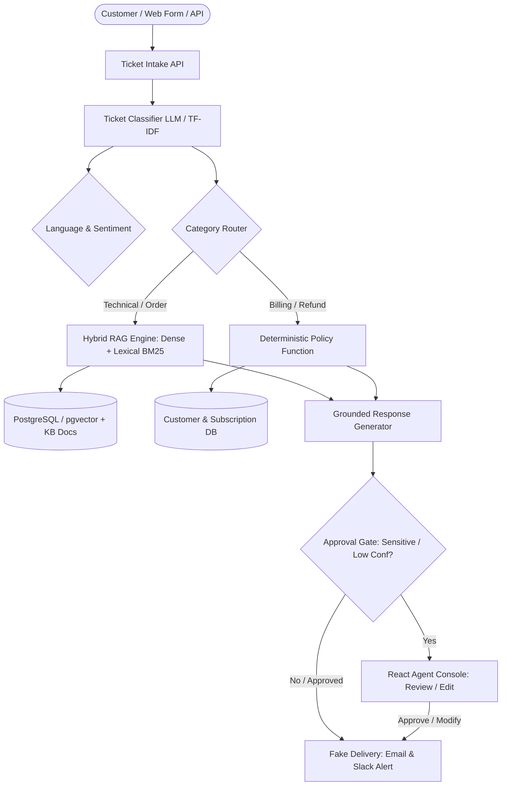

# HelpdeskFlow: RAG + Tool-Calling Support Automation with Human Approval

[](https://github.com/example/helpdeskflow/actions)


HelpdeskFlow is an enterprise support-ticket workflow automation system designed for internet service providers (ISPs) and e-commerce platforms. Built around a fictional Bangladesh ISP and online shop (**"BengalNet & Bazar"**), it triages tickets across English, Bangla, and Banglish, retrieves grounded documentation with citations via hybrid RAG (dense + BM25 TF-IDF), enforces deterministic business policies, and gates sensitive actions behind human supervisor approval.

---

## Status Table

| Component | Status | Verification Evidence |
|---|---|---|
| Milestone 1: Skeleton, Makefile, CI, Docker Compose | **Done** | `pytest apps/api/tests/test_health.py` passing |
| Milestone 2: Synthetic Data & Seed (KB, Customers, Tickets) | **Done** | 44 KB docs, 220 customers, 160 tickets generated & seeded |
| Milestone 3: KB Ingestion, Hybrid Retrieval & Citations | **Done** | **Recall@5 = 95.56%** on held-out golden set |
| Milestone 4: Ticket Classifier with Schema Validation | **Done** | Validated Pydantic v2 schemas + TF-IDF baseline benchmark |
| Milestone 5: Workflow State Machine & LangGraph Logic | **Done** | Intake -> Classify -> Retrieve -> Draft -> Policy -> Gate |
| Milestone 6: Agent Console (React/Vite/TS) & Demo | **Done** | Built Vite SPA + `make demo` (32ms avg latency) |
| Milestone 7: Safe Tools & Identity Verification | **Planned** | Deterministic refund policy function & identity matching |
| Milestone 8: Approval Gate & Fake Providers | **Planned** | Async paused state persistence & email/slack logging |
| Milestone 9: Guardrails & Security Testing | **Planned** | PII masking, prompt injection defense, budget enforcement |
| Milestone 10: Evaluation Harness & Ablations | **Planned** | Comprehensive Golden Set & Adversarial eval suite |
| Milestone 11: Analytics Dashboard & Feedback Loop | **Planned** | Latency, token budget, auto-resolution metrics |
| Milestone 12: Docs, Deployment Config & DoD Sign-off | **Planned** | Interview notes, CV bullets, and free tier deploy |

---

## System Architecture



---

## Quickstart

### 1. Prerequisites
- Python 3.11+
- Node.js 20+

### 2. Setup
```bash
# Clone and setup environment
cp .env.example .env
python3 -m venv .venv
source .venv/bin/activate
pip install -r requirements.txt

# Seed database and ingest knowledge base
make synth
make seed

# Run automated end-to-end demo
make demo
```

### 3. Run Services
```bash
# Start backend API (Port 8100)
make run

# Start agent console (Port 3000)
cd apps/web && npm install && npm run dev
```

---

## Safety & Human-in-the-Loop Safeguards
1. **Deterministic Refund Function**: The LLM is strictly prohibited from granting refunds or credits. Policy eligibility is hardcoded in deterministic python logic (`check_refund_policy`).
2. **Approval Gate**: Low confidence (< 0.75), sensitive categories (billing disputes, legal threats, cancellations, refunds) are automatically paused in `awaiting_approval` status.
3. **Identity Verification**: Sensitive customer details and billing status require authenticated identity checks.
