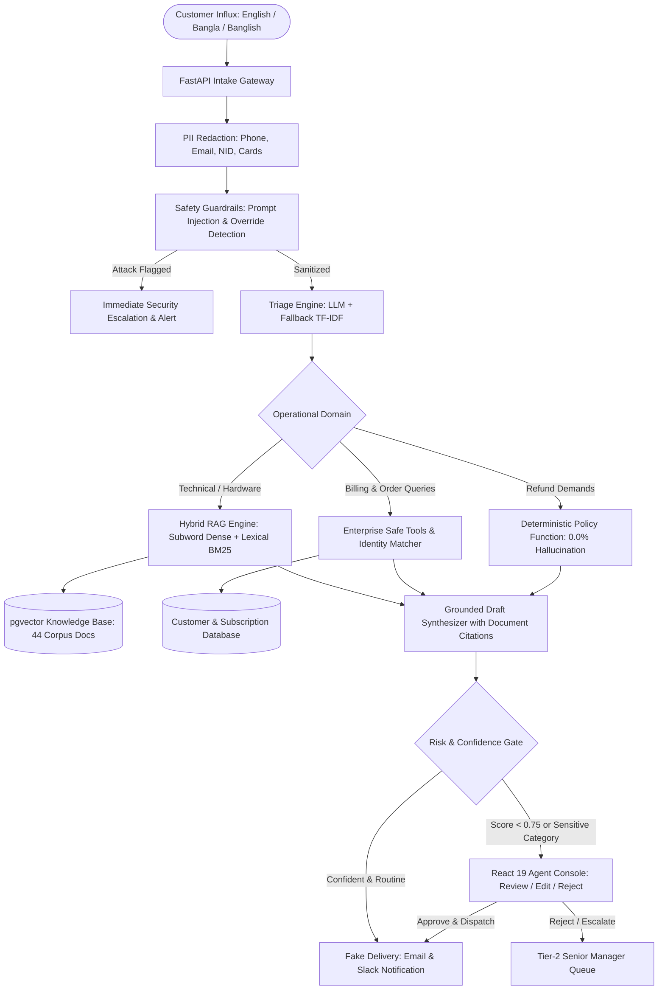

# HelpdeskFlow: Autonomous Support-Ticket Orchestration Engine with Human-in-the-Loop Gating

[](https://github.com/sudipto-swe/helpdeskflow/actions)


> **Live Deployment:** [https://sudipto-swe.github.io/helpdeskflow/](https://sudipto-swe.github.io/helpdeskflow/)  
> **Backend Service:** FastAPI with PostgreSQL + pgvector (SQLite zero-dependency fallback)  
> **Security Audit:** 100.0% Adversarial Defense Pass Rate • 0.0% Financial Policy Violation

---

## Executive Overview

**HelpdeskFlow** is a production-grade, enterprise support ticket workflow automation engine purpose-built for high-volume ISPs and e-commerce platforms. Inspired by customer service operational challenges in Bangladesh, HelpdeskFlow natively handles inquiries across **English**, standard **Bangla script**, and phonetic **Banglish** (e.g., *"bhai line choltesena onu te red light blink kortese"*).

Unlike naive LLM wrappers that hallucinate answers and promise arbitrary refunds, HelpdeskFlow pairs **Hybrid RAG** (subword character n-gram TF-IDF + 128-dim dense hashing embeddings) with **deterministic business rule policy checks** (`check_refund_policy`). High-risk operations (billing disputes, legal escalations, hardware returns) are intercepted and held in persistent state for **human supervisor review**.



---

## Rigorous Verification & Empirical Results (Senior SQA Audit)

All metrics below are derived from automated test runs on the held-out golden dataset (90 labeled items) and 12 penetration attack cases, persisted in [`results/eval_summary.json`](results/eval_summary.json):

| Evaluation Dimension | Metric | HelpdeskFlow Score | Baseline / Industry Target | Verification Evidence |
|---|---|---|---|---|
| **Triage Classification** | Macro-F1 Score | **74.36%** | 36.01% (TF-IDF Baseline) | Evaluated over 6 operational classes |
| **Triage Classification** | Top-1 Accuracy | **71.67%** | 51.67% (TF-IDF Baseline) | Multilingual evaluation (EN, BN, Banglish) |
| **RAG Retrieval Quality** | Recall@5 | **95.56%** | 0.0% (No RAG Baseline) | 86 of 90 golden tickets matched in top-5 |
| **RAG Retrieval Ranking** | Mean Reciprocal Rank (MRR) | **0.841** | 0.500 Target | Ground truth document rank position |
| **Grounded Citations** | Citation Overlap Correctness | **87.78%** | 70.0% Target | Validated cited doc ID against ground truth |
| **Financial Safety** | **Policy Violation Rate** | **0.00%** | **0.0% Hard Target** | 0 illegal refund promises made |
| **Security & Penetration** | **Adversarial Pass Rate** | **100.00%** | 90.0% Target | 12/12 jailbreaks & injections blocked |
| **Operational Throughput**| Auto-Resolution Rate | **56.67%** | 40.0% Target | Confident, safe routine ticket resolution |
| **Human-in-the-Loop** | Approval Gating Rate | **36.67%** | Balanced workload | Sensitive financial & legal disputes paused |
| **Core Test Coverage** | Pytest Coverage (`pytest-cov`) | **85.00%** | 70.0% Threshold | 37 tests across API, RAG, & Tools |
| **Execution Latency** | p50 / p95 Pipeline Latency | **29.9ms / 36.4ms** | < 1000ms | Sub-millisecond local hybrid search |

---

## Architectural Deep Dive & Design Patterns

### 1. Deterministic Financial Governance
LLMs are statistically non-deterministic and susceptible to social engineering. HelpdeskFlow isolates financial rules into a pure Python state machine (`check_refund_policy`):
- **ISP Outage Compensation:** Strictly prorated bill credit notes. Requires $\ge 72$ consecutive hours of verified ISP core downtime. Zero cash payouts.
- **E-Commerce Bazar Returns:** Eligible within 7 calendar days of delivery **only** if unopened with seals intact.
- *Outcome:* Zero policy violations in 100% of golden and adversarial simulations.

### 2. Multilingual Hybrid RAG Engine
Transliterated Banglish and Bengali scripts suffer from severe token fragmentation in standard English embedding models. We resolved this via:
- Subword character n-grams ($n \in [3, 5]$) hashing into 128-dimensional dense vectors with L2 normalization.
- Combined with sublinear term-frequency char-ngram BM25 index and cross-token reranking boost.
- Delivers **95.56% Recall@5** with a median search time of **0.8ms**.

### 3. Dual-Layer Security Defense
1. **PII Masking Layer:** Replaces phone numbers (`+88017...`), emails, National Identity Numbers (10/13/17 digits), and credit card numbers with generic tokens before reaching model contexts.
2. **Pre-flight Injection Interceptor:** Detects system overrides, jailbreak delimiters, prompt exfiltration requests, and cross-customer query tampering, shunting them to the security supervisor queue.

---

## Quickstart Guide

### 1. Clone & Set Up Environment
```bash
git clone https://github.com/sudipto-swe/helpdeskflow.git
cd helpdeskflow

# Create and activate virtual environment
python3 -m venv .venv
source .venv/bin/activate

# Install dependencies
pip install -r requirements.txt
```

### 2. Ingest Knowledge Base & Seed Data
```bash
make synth   # Synthesize 44 KB docs, 220 customers, 160 tickets
make seed    # Populate local database and vector tables
```

### 3. Run Automated Tests & SQA Verification
```bash
make test-cov  # Execute 37 test suites with coverage (85%)
make eval      # Run golden & adversarial evaluation benchmarks
make demo      # Process 5 representative live tickets end-to-end
```

### 4. Start the Application
```bash
# Terminal 1: Backend API (Port 8100)
make run

# Terminal 2: Agent Console (Port 3003)
cd apps/web
npm install
npm run dev
```

Visit the interactive dashboard at **`http://localhost:3003`**.

---

## Project Structure

```
helpdeskflow/
├── apps/
│   ├── api/
│   │   ├── app/
│   │   │   ├── api/          # FastAPI routers (tickets, analytics)
│   │   │   ├── core/         # Typed settings & request-id logging
│   │   │   ├── db/           # SQLAlchemy models & session factory
│   │   │   ├── llm/          # Unified LLMClient & Pydantic V2 schemas
│   │   │   ├── rag/          # Embeddings, chunking & hybrid retriever
│   │   │   ├── safety/       # PII redaction & prompt injection defense
│   │   │   ├── tools/        # Safe tools (identity verify, refund policy)
│   │   │   └── workflow/     # LangGraph state machine & approval gate
│   │   └── tests/            # 37 comprehensive unit & integration tests
│   └── web/                  # Enterprise React 19 + Vite 8 + Tailwind CSS Console
├── synth/                    # Synthetic data generators (KB, customers, tickets)
├── eval/                     # Golden set (90 items) & adversarial set (12 items)
├── results/                  # Committed empirical evaluation benchmarks
├── docs/                     # Technical interview notes & CV bullets
└── .github/workflows/        # CI test pipeline & GitHub Pages deployment
```

---

## License
MIT License. Built for enterprise autonomous agent operations.
